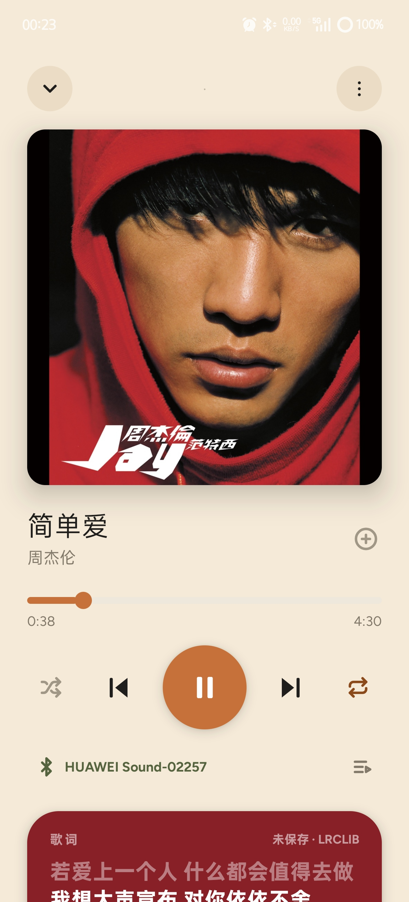
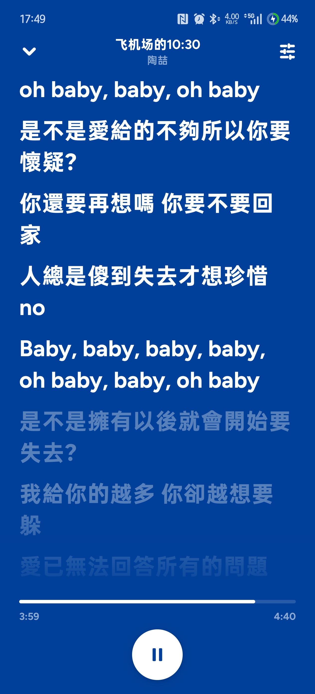
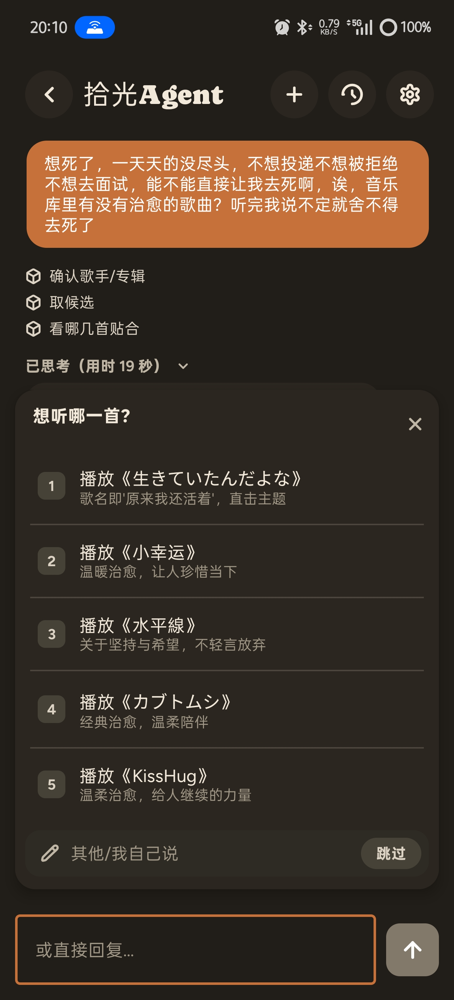

# 拾音PickUpMusic

> 本地音乐播放器从来不缺，缺的是完整的音乐体验。

不同来源下载的本地音乐，往往缺少对应封面、歌词或完整的专辑信息；普通播放器通常只能把文件播放出来，如想获得完整如同流媒体的体验，用户要付出高昂的时间成本去手动添加附带内容。拾音便是为了解决这个痛点开发的。

<p align="center">
  
  
</p>

<p align="center">
  
  
</p>

## 核心能力

### 1. 音乐资源匹配 —— 自动补全缺失的歌词、封面与信息

- **歌词自动匹配**：LRCLIB、网易云音乐、LrcShare 三源级联，能够识别大部分音乐，并允许用户上传 lrc 文件进行补充；歌词来源整合为五个选项，也可以自己添加来源，或让 Agent 联网去找。（LrcShare 需要你自己申请并填写 API Key，见「设置 → 歌词源管理」；未填写时该源不会被使用。）
- **歌词翻译**：外文歌词可译成中文，与原文逐行对照。
- **封面自动匹配**：从 iTunes 拉取候选封面，自动识别最符合的一张，若不匹配亦可手动修改。
- **歌曲信息**：基于文件名与已有元数据，允许用户更改修正专辑、歌曲、歌手信息，解决本地音乐信息错误的问题。
- **歌手写真自动获取**：从 Discogs、AudioDB 等多源并行匹配歌手人物写真，可手动挑选 / 粘贴链接 / 选本地文件替换，小众歌手回退专辑封面。

### 2. 伴唱与升降 Key（BETA）

- **人声 / 伴奏分离**：伴唱打开后，当前歌曲被拆成人声与伴奏两条轨，播放中随时在人声 / 原曲 / 伴奏三档间切换；分离结果会缓存，切回来不用重算。
- **分离模型可选**：默认模型随包安装、开箱即用；另外两个更大的模型（含一个直接输出伴奏的）可在设置里按需下载。模型与分轨缓存的占用都能看到，也可清理删除——不玩伴唱的话删掉即可，不影响其他功能。
- **升降 Key**：最多 ±6 个半音的实时变调，点一下走 1 个半音、长按走 0.5，配合伴奏在家就能唱。


### 3. 本地音乐库信息管理 —— 辟除杂音

- **排除特定的文件夹或音频文件**：普通录音、通话录音、通知音、其他 App 的音频，可被设置挡在音乐库之外，而不是默认扫描进来再一个个手动删。
- **歌手归一化**：可手动合并同一歌手的多个名字（如 `fujiikaze` / `藤井风`），并支持事后修改撤销。

### 4. 以专辑为中心

- **无缝播放（gapless）**：丝滑播放体验，不把专辑曲目之间的衔接打断。
- **整轨拆分为单曲**：整轨专辑（一个文件装完整张专辑）可按曲目清单拆成单曲显示——单独收藏、加入歌单、看歌词都行，连着播依旧无缝。
- **专辑歌曲排序**：解决专辑内歌曲乱序的问题，支持手动拖拽排序、文本排序模式和一键复制当前顺序交给 AI 联网排序后粘回。
- **专辑与歌曲分开维护**：一张专辑的元数据单独编辑，不与单首歌耦合；歌曲归属专辑可以单独迁移。

### 5. 更接近音乐软件的体验

- **歌手主页**：沉浸式写真折叠头，上下滑歌手名平滑滑入顶栏，Spotify 式一镜到底；写真多源自动获取，可手动替换。
- **搜索**：专辑名命中整张置顶、跨字段分词匹配，结果首位为歌手行（圆头像）；支持假名与罗马字，用 romaji 也能搜到日文歌。
- **歌单**：自建歌单，专辑式大封面（多专辑自动拼贴）+ 每曲显各自封面；内置不可删的「我的喜欢」。
- **音频输出路由**：自由切换扬声器 / 耳机 / 蓝牙。
- **歌词本**：仿 Spotify 界面的全屏歌词阅读界面，配色随封面联动；另有独立设置页（振假名默认开关、自动校验、歌词配色）。
- **振假名**：日语歌词汉字上方标注假名注音（歌词本展开页「あ」开关），部分错误可长按修改；内置词典之外，再对照外部读物来源与模型判断，生僻词读错得更少。
- **主题**：跟随系统 / 浅色 / 深色三档，跟着手机的深浅走或自己定。
- **收听统计**：查看每周收听情况、最近播放记录，以及通过「你的更新」了解音乐库中新识别和新增的专辑。

### 6. Agent —— 用说话的方式整理音乐库

- **对话式整理**：首页进入 Agent，直接对话——「把《XX》按官方顺序排一下」「这首歌歌手识别错了」「这首歌的歌词给我找一下」，AI 联网搜证、逐步执行，每步进度实时可见，写库前经你确认。
- **批量改歌名**：说「把这张专辑每首歌名的 - 歌手名 后缀去掉」「繁体转简体」「片假名换成汉字官方名」，AI 逐首分析、列出「旧名 → 新名」改动清单后写回，随时可在曲目菜单改回；也可以点名「把 A 改成 B」单改一首。
- **根据曲库询问**：「音乐库里有没有这首歌」「我最近在听什么」，回答基于真实音乐库与播放次数，不靠 AI 瞎编；事实性问题会先联网核实再答。
- **它会记住你**：聊过的偏好与近况跨对话保留，可在设置里开关、按页分组查看。
- **按场景推荐**：说「推荐几首适合雨天听的」，它从你的曲库里挑，并说明每首的理由。
- **对话有历史**：过往对话可回看，也能把对话现场导出成文件。
- **自带主流模型配置，亦可自由设置供应商**：DeepSeek、OpenRouter、智谱、通义预设一键填入，或自定义任意 OpenAI 兼容服务商；设置页可查看 Token 用量趋势（输入 / 输出 / 缓存命中 / 成本曲线）。模型知识面不够时，可以打开「强制联网搜索」，让它先查再答，不凭记忆猜。

### 7. 数据与备份

- **备份与恢复**：一键导出 zip（连本地图片一起打包），恢复前可预览要恢复什么，本地还会自动留快照；也可以备份到你自己的 WebDAV（坚果云、Nextcloud、群晖等兼容服务）。
- **换机可迁移**：曲库按数据路径重解析，不依赖本机媒体库编号，换台设备也找得回。

## 下载与构建

```bash
git clone https://github.com/richenxiao/pickupmusic.git
cd pickupmusic
./gradlew assembleDebug        # Windows 下用 gradlew.bat
```

产物路径：`app/build/outputs/apk/debug/app-debug.apk`

环境要求：JDK 17+、Android SDK 36（compileSdk / targetSdk）、最低支持 Android 12（minSdk 31）。仓库自带 Gradle Wrapper，克隆后无需全局安装 Gradle。

### 构建 Release（需自行配置签名）

仓库不含任何真实签名密钥与密码。要构建 Release，按 `keystore.properties.example` 自行准备你自己的签名：

1. 生成你自己的 keystore：
   ```bash
   keytool -genkey -v -keystore my-release.keystore -alias my-key \
     -keyalg RSA -keysize 2048 -validity 10000
   ```
2. 复制 `keystore.properties.example` 为 `keystore.properties`，填入你的 keystore 路径与密码。
   （`keystore.properties` 与 `*.jks` / `*.keystore` 均在 `.gitignore`，不会被提交。）
3. 构建：
   ```bash
   ./gradlew assembleRelease
   ```

产物路径：`app/build/outputs/apk/release/app-release.apk`


## 技术栈

| 技术 | 用途 |
|------|------|
| Kotlin | 开发语言 |
| Jetpack Compose | UI 框架 |
| Material 3 | 设计系统 |
| AndroidX Media3 (ExoPlayer) | 音频播放引擎，后台播放 + MediaSession |
| Room / DataStore | 本地数据库 / 键值偏好 |
| Coroutines / Flow | 异步与响应式 |
| OkHttp / Gson | 网络请求 / JSON 解析 |
| AndroidX Palette | 专辑封面主色提取，驱动动态取色 |

完整版本号、依赖与构建细节见 `app/build.gradle.kts`。

## 项目结构

```
PickUpMusic/
├── app/
│   ├── src/main/
│   │   ├── java/com/shiyin/music/
│   │   │   ├── data/
│   │   │   │   ├── ai/              # 拾光 Agent（对话引擎、工具调用、技能、记忆）
│   │   │   │   ├── memory/         # 长期记忆（规则、存取、可观测）
│   │   │   │   ├── colors/          # 封面主色提取（PaletteExtractor）
│   │   │   │   ├── normalize/       # 歌手名归一化
│   │   │   │   ├── image/            # 歌手写真解析层（多源 resolver + 缓存 + 覆盖）
│   │   │   │   ├── recognition/     # 歌手头像抓取
│   │   │   │   ├── db/             # Room 数据库（实体、DAO、迁移、备份导入导出）
│   │   │   │   ├── backup/         # WebDAV 云备份客户端
│   │   │   │   ├── split/          # 整轨专辑拆分为单曲（方案模型与解析）
│   │   │   │   ├── lyrics/         # 歌词解析与匹配（LRC / USLT / LRCLIB / 网易云）
│   │   │   │   ├── translate/      # 歌词翻译管线
│   │   │   │   ├── furigana/       # 振假名（分词、hash、外部读物来源）
│   │   │   │   ├── stats/          # 收听统计口径
│   │   │   │   ├── update/         # 检查更新（只读 GitHub Releases）
│   │   │   │   ├── MediaScanner.kt  # 媒体库扫描
│   │   │   │   └── SettingsStore.kt  # DataStore 设置与最近播放
│   │   │   ├── playback/            # 后台播放服务、播放控制器、音频设备路由
│   │   │   ├── ui/
│   │   │   │   ├── components/      # 通用 UI 组件
│   │   │   │   ├── screens/         # 页面（首页 / 搜索 / 音乐库 / 播放器 / 歌词 / 设置 等）
│   │   │   │   └── theme/           # 主题与配色
│   │   │   ├── MainActivity.kt
│   │   │   ├── MainViewModel.kt
│   │   │   └── AppRoot.kt           # 导航根组件
│   │   ├── res/                     # 资源文件（含各档位应用图标）
│   │   └── AndroidManifest.xml
│   └── build.gradle.kts
├── gradlew / gradlew.bat            # Gradle Wrapper（仓库自带）
├── keystore.properties.example      # Release 签名占位模板
├── local.properties.example         # 本机 Android SDK 路径占位模板
├── LICENSE                          # MIT 许可证
└── README.md
```

## 隐私说明

- 本地音乐扫描与播放均在设备本地完成。
- 网络访问仅用于：抓取歌手写真（Discogs / AudioDB / Fanart 等多源）、匹配歌词与封面（LRCLIB / 网易云 / LrcShare / iTunes）、Agent 联网搜索（Tavily）、调用你自配的模型服务商做元数据识别与对话。LrcShare 使用**你自己申请并保存在本机**的 API Key，未填写时不会向它发起任何请求。
- 不会上传你的本地音乐文件或收听记录到任何服务器。
- 导出的备份文件**包含 API Key（明文）**，包括 WebDAV 备份在内，请勿放在公开位置。
- 你的 API Key 与偏好设置不随系统云备份上传；换机迁移与 App 自带的备份文件不受影响。

## 许可证

本项目基于 MIT 许可证开源。详见 [LICENSE](LICENSE)。
